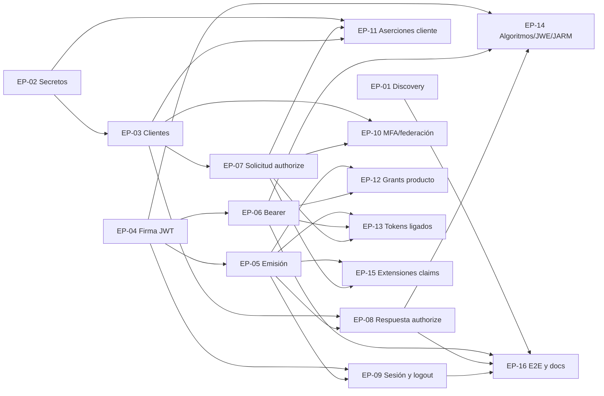

# Épicas de implementación — tareas 022 a 071

Agrupación de las 50 tareas pendientes de `docs/TODD/` (sin `done/` ni `review/`) en épicas que conviene implementar juntas. Cada épica reúne tareas que:

- tocan los **mismos archivos calientes** (un solo PR evita conflictos y refactorizaciones repetidas);
- comparten un **mismo componente nuevo** (puerto, servicio, tabla) que se diseña una vez;
- o dependen de la **misma decisión** de diseño o de producto.

Las fichas originales siguen siendo la referencia de evidencias y criterios de aceptación. Cada épica indica el orden interno, el componente común y lo que deja preparado para las siguientes. Los cambios de datos remiten a [MODELO_Y_ESQUEMA_018-071.md](../MODELO_Y_ESQUEMA_018-071.md).

> Los enlaces apuntan a `docs/TODD/<nnn>-*.md`. Al mover una tarea a `done/` hay que actualizar el enlace en su épica.

## Resumen

| Épica | Tareas | Prioridad | Tamaño | Depende de |
|---|---|---|---|---|
| [EP-01 Discovery honesto](../done/EP-01-discovery-honesto.md) (hecha) | [030](../done/030-discovery-honesto.md) (+ retirada de anuncios de 034, 037, 045, 046, 053–057, 060–062, 067) | alta | S | — |
| [EP-02 Secretos y criptografía en reposo](EP-02-secretos-y-cifrado.md) | 071, 063 | crítica | L | — |
| [EP-03 Clientes: tenant, DCR y metadatos](../done/EP-03-clientes-tenant-dcr.md) (hecha) | [022](../done/022-clientes-aislados-por-tenant.md), [023](../done/023-validar-acceso-inicial-dcr.md), [024](../done/024-limitar-grants-y-ropc.md), [065](../done/065-metadatos-cliente-inoperantes.md) | alta | L | EP-02 fase A (mismos adapters) |
| [EP-04 Firma JWT por propósito y claves](../done/EP-04-firma-jwt-y-claves.md) (hecha) | [025](../done/025-jwt-kid-y-proposito.md), [029](../done/029-rotacion-claves-fuera-request.md) | crítica | M | — |
| [EP-05 Emisión de tokens y claims](EP-05-emision-tokens-y-claims.md) | 038, 032, 049, 064 (+ `sid` público) | alta | L | EP-04 |
| [EP-06 Validación de bearer en consumidores](EP-06-validacion-bearer.md) | 026, 028, 035 | crítica | M | EP-04 |
| [EP-07 Autorización: origen y política de la solicitud](EP-07-autorizacion-solicitud.md) | 046, 047, 034, 068 (opc.) | alta | L | EP-03 |
| [EP-08 Autorización: construcción de la respuesta](EP-08-autorizacion-respuesta.md) | 027, 037, 033, 070, 045 (opc.) | alta | M | EP-03, EP-05 (hashes) |
| [EP-09 Sesión SSO y logout](EP-09-sesion-sso-y-logout.md) | 031, 036, 067 (opc.), 041 (opc.), 062 (opc.) | alta | M | EP-04, EP-05 |
| [EP-10 Login de usuario: MFA y federación](EP-10-login-mfa-y-federacion.md) | 039, 040 (opc.), 051 (opc.) | media | S + opc. | EP-03 (040), EP-07 (051) |
| [EP-11 Aserciones JWT de cliente](EP-11-aserciones-jwt-cliente.md) | 044, 069 (opc.) | media | M | EP-02 (decisión), EP-03, EP-07 |
| [EP-12 Grants por decisión de producto](EP-12-grants-decision-producto.md) | 043, 052, 055 | baja | decisión + M/L | EP-05, EP-06 |
| [EP-13 Tokens ligados a clave o certificado](EP-13-tokens-ligados.md) | 048, 053 | baja | L | EP-05, EP-06, EP-07 |
| [EP-14 Algoritmos, firma y cifrado avanzados](EP-14-algoritmos-firma-cifrado.md) | 050, 054, 057, 060 | baja | L | EP-04, EP-06, EP-08 |
| [EP-15 Extensiones de autorización y claims](EP-15-extensiones-autorizacion-claims.md) | 056, 058, 059, 061 | baja | L | EP-05, EP-07 |
| [EP-16 Cierre: E2E, conformidad y documentación](EP-16-e2e-conformidad-docs.md) | 042, 066 | alta | L | todas (fase 0 al inicio) |

Tamaño orientativo: **S** ≤ 2 días, **M** ≈ 1 semana, **L** > 1 semana. «opc.» = tarea condicionada a decisión de producto; la épica incluye su retirada de discovery (EP-01) y deja preparado el terreno, pero no la implementa sin aprobación.

## Dependencias

## Orden recomendado (olas)

| Ola | Épicas | Motivo |
|---|---|---|
| 0 — inmediata | EP-01, EP-02 fase A, EP-16 fase 0 | Riesgo bajo y efecto inmediato: dejar de anunciar lo que no existe, `hash_equals`, arnés de pruebas MySQL |
| 1 — seguridad crítica | EP-04, EP-02 (resto), EP-03 | Firma por propósito con `kid`, secretos no recuperables, aislamiento de clientes por tenant |
| 2 — consumidores y emisión | EP-06, EP-05 | Validación estricta de bearer; emisión centralizada y `sid` público |
| 3 — authorize | EP-07, EP-08 | Ambas tocan `AuthorizeHtml`: secuenciales o con el mismo responsable |
| 4 — sesión y login | EP-09, EP-10 (039) | Necesitan `auth_time`/`amr`/`sid` expuestos por EP-05 |
| 5 — cierre | EP-16 fases 1–2 | Escenarios encadenados, OpenID Conformance Suite, documentación |
| Bajo demanda | EP-11 a EP-15 y opcionales de EP-08/09/10 | Solo con caso de uso aprobado; EP-01 ya retiró sus anuncios |

Paralelizable sin conflicto: EP-04 ‖ EP-03 ‖ EP-02 (si fase A ya está fusionada), EP-06 ‖ EP-05 (tras EP-04), EP-07 ‖ EP-09.

## Hallazgos transversales

1. **El `sid` publicado es el valor de la cookie.** [LogoutController.php:129](../../../src/Features/OAuth/Authentication/Infrastructure/Driver/Rest/LogoutController.php#L129) añade `sid=$sessionId` al front-channel, y el refresh y el logout token llevan el mismo identificador de `_oauth_session.session`. Es el hallazgo 2 de [MODELO_Y_ESQUEMA](../MODELO_Y_ESQUEMA_018-071.md) y no tiene tarea propia; se aborda en **EP-05 paso 1** y conviene adelantarlo si EP-05 se retrasa.
2. **`ClientData` como snapshot único.** 024, 033, 034, 046, 053, 056, 057, 060 y 065 añaden cada una un metadato. EP-03 los mapea todos de una vez, y las demás épicas solo los consumen.
3. **Almacén anti-replay compartido** `_oauth_replay_jti` (B.2): se crea en EP-07 (047) y lo reutilizan EP-11 (044, 069) y EP-13 (048).
4. **Descarga segura de JWKS remoto**: se extrae de `RequestObjectValidator` en EP-07 y la reutilizan EP-10 (051), EP-11 (044) y EP-14 (057).
5. **`TokenSigner` por propósito** (EP-04) es la base de 049, 032, 026, 028, 036 (`id_token_hint`), 054, 057 y 060.
6. **Constructor único de respuestas de autorización** (EP-08): query, fragment y, más adelante, `form_post` (045) y JARM (054) son modos del mismo componente.
7. **Discovery por capacidades** (EP-01): cada épica posterior activa su flag en lugar de editar el documento a mano, y el test de contrato impide anunciar lo no registrado.

## Archivos calientes

| Archivo | Épicas que lo tocan | Recomendación |
|---|---|---|
| `Authentication/Infrastructure/Driver/Rest/TokenController.php` | 03, 04, 05, 07, 11, 12, 13 | EP-05 extrae la emisión (038) **antes** de que lleguen 11–13 |
| `Authentication/Infrastructure/Driver/Html/AuthorizeHtml.php` | 07, 08, 09, 15 | EP-07 y EP-08 en serie o con el mismo responsable |
| `Html/Services/OidcResponseBuilder.php` | 05, 08, 14 | EP-08 lo reduce a un constructor de respuestas |
| `Client/Infrastructure/Driven/ClientStoreAdapter.php`, `DynamicClientAdapter.php` | 02, 03, 07, 11 | EP-02 fase A → EP-03 → EP-02 fases B–E |
| `TokenSecurity/Infrastructure/Driven/JoseTokenSigner.php` | 04, 14 | EP-04 completo antes de cualquier algoritmo nuevo |
| `Bootstrap/Middleware/JwtVerifierMiddleware.php` | 06, 13 | EP-06 define la política; EP-13 la amplía |
| `Oidc/Domain/OpenIdConfiguration.php` | todas | Tras EP-01, solo cambios de flag |

## Decisiones pendientes que bloquean

| Decisión | Épica | Recomendación de las fichas |
|---|---|---|
| Opción A/B/C para el secreto de cliente | EP-02, EP-11 | A (HMAC + *pepper*); 044 solo `private_key_jwt` |
| Clientes globales permitidos y regla de migración | EP-03 | `tenant = null` = global, gestionable solo por root |
| Initial access token: entidad propia o JWT `dcr:register` | EP-03 | Entidad `dcr-initial-access-token` (ya en el modelo) |
| Semántica de `audiences`: «todas» o «al menos una» | EP-06 | «Al menos una» (RFC 7519 §4.1.3) |
| Retirar o mantener `implicit` | EP-01, EP-08 | Retirar (OAuth 2.1) |
| Re-hash de contraseñas en bloque o perezoso | EP-02 | En bloque |
| Aprobar cada opcional (040, 041, 043, 044, 045, 048, 050–062, 067–069) | varias | Ver ficha |

## Mapa tarea → épica

| Tarea | Épica | Tarea | Épica | Tarea | Épica |
|---|---|---|---|---|---|
| 022 | EP-03 | 039 | EP-10 | 056 | EP-15 |
| 023 | EP-03 | 040 | EP-10 | 057 | EP-14 |
| 024 | EP-03 | 041 | EP-09 | 058 | EP-15 |
| 025 | EP-04 | 042 | EP-16 | 059 | EP-15 |
| 026 | EP-06 | 043 | EP-12 | 060 | EP-14 |
| 027 | EP-08 | 044 | EP-11 | 061 | EP-15 |
| 028 | EP-06 | 045 | EP-08 | 062 | EP-09 |
| 029 | EP-04 | 046 | EP-07 | 063 | EP-02 |
| 030 | EP-01 | 047 | EP-07 | 064 | EP-05 |
| 031 | EP-09 | 048 | EP-13 | 065 | EP-03 |
| 032 | EP-05 | 049 | EP-05 | 066 | EP-16 |
| 033 | EP-08 | 050 | EP-14 | 067 | EP-09 |
| 034 | EP-07 | 051 | EP-10 | 068 | EP-07 |
| 035 | EP-06 | 052 | EP-12 | 069 | EP-11 |
| 036 | EP-09 | 053 | EP-13 | 070 | EP-08 |
| 037 | EP-08 | 054 | EP-14 | 071 | EP-02 |
| 038 | EP-05 | 055 | EP-12 | | |
